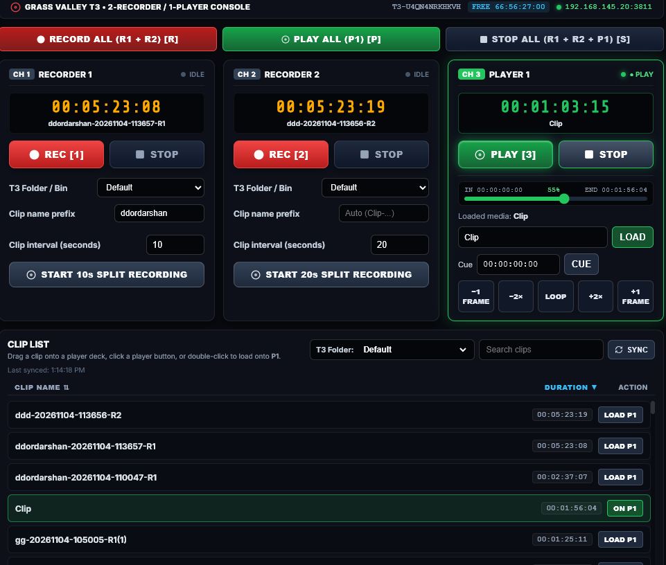

# Grass Valley T3 iDDR Broadcast Controller (Next.js & AMP Protocol)



A professional, broadcast-grade software control surface for the **Grass Valley T3 iDDR** (and T2 / K2 media servers) built with **Next.js (JavaScript / React)** and the **Advanced Media Protocol (AMP)** over TCP port **3811**.


---

## 🌟 Key Features

### 1. Auto-Sensed Multi-Channel Deck Architecture
Automatically probes your Grass Valley T3 (`vtr_r1`, `vtr_r2`, `vtr_r3`, `vtr_p1`, `vtr_p2`) via `CRAT` and adapts the 3-channel UI and master transport buttons to match your T3's active hardware mode:
- **2-Recorder / 1-Player (`2R / 1P`)**: `CH 1: R1` (`vtr_r1`), `CH 2: R2` (`vtr_r2`), `CH 3: P1` (`vtr_p1`)
- **3-Recorder (`3R`)**: `CH 1: R1` (`vtr_r1`), `CH 2: R2` (`vtr_r2`), `CH 3: R3` (`vtr_r3`)
- **1-Recorder / 2-Player (`1R / 2P`)**: `CH 1: R1` (`vtr_r1`), `CH 2: P1` (`vtr_p1`), `CH 3: P2` (`vtr_p2`)

### 2. Recorder & Player Deck Controls
- **Recorder Decks (`R1`, `R2`, `R3`)**:
  - `REC` / `STOP` illuminated tally buttons with live hardware status feedback.
  - **T3 Folder / Bin Selector**: Choose which T3 storage folder (`Default`, `Bin`, watch folders, etc.) each recorder writes into (`A2.0E` / `A0.0F`).
  - **Custom Clip Name Prefix**: Configure a per-recorder prefix (persisted across reloads in `localStorage` and `logs/interval-settings.json`); recordings automatically cue a timestamped clip name (`<prefix>-YYYYMMDD-HHMMSS-R1`) via `AE.02` followed by `20.02`.
  - **Persistent Split / Interval Recording**: Continuously record into consecutive clips of a configurable duration (persisted across browser and server restarts).
- **Player Decks (`P1`, `P2`)**:
  - `PLAY` / `STOP` illuminated tally buttons.
  - **Interactive Timeline Seek Bar**: Displays clip `IN` timecode, `%` progress, and `END` timecode (`A2.17` / `A2.25`). Drag or click anywhere on the timeline to scrub/cue (`24.31`) the T3 player with automatic playback resumption.
  - **Precision Transport Controls**:
    - `−1 FRAME` / `+1 FRAME`: Frame-accurate step backward/forward (`24.31` at 25 fps PAL).
    - `−2×` / `+2×`: True 2.0× reverse and forward shuttle (`21.23.4A` / `21.13.4A`).
    - `● LOOP`: Toggles hardware loop mode (`41.42.01` / `41.42.00`) and automatically senses live loop state from the T3 (`61.20.05` status byte 4 bit `0x20`).
- **Broadcast Keyboard Shortcuts**:
  - <kbd>1</kbd> / <kbd>2</kbd> / <kbd>3</kbd>: Toggle transport on CH 1 / CH 2 / CH 3
  - <kbd>R</kbd>: Record All active recorders
  - <kbd>P</kbd>: Play All active players
  - <kbd>S</kbd> / <kbd>Esc</kbd>: Stop All channels

### 3. Clip List, Folder Browser & Sorting
- **T3 Folder / Bin Switcher**: Switch folders directly from the Clip List header to browse and load media from any T3 folder (`A0.27` / `A2.0E`).
- **Live Clip Directory & Durations**: Multi-clip packet unpacking (`A2.14` / `A1.15` → `8A.14` / `80.14`) with automatic background duration lookups (`A2.17` → `84.17`) displayed as `HH:MM:SS:FF` badges on every row.
- **Sortable Columns**: Click **`CLIP NAME ▲/▼`** (natural alphanumeric sort) or **`DURATION ▲/▼`** (shortest/longest sort) to organize the clip grid, plus instant search filtering.
- **Safe Multi-Player Loading**:
  - Single-clicking a clip row does **not** interrupt playback.
  - Double-click a clip row, drag-and-drop it onto a player deck, or click **`LOAD P1`** / **`LOAD P2`** (with a **`Dbl-click → [P1] [P2]`** target selector when 2 players are active).

### 4. System Telemetry & Live AMP Protocol Logging
- **Top Status Bar**: Displays sensed T3 hardware profile (`2R / 1P`, `3R`, `1R / 2P`), T3 system hostname (`A0.2C`), remaining free record time (`A0.1C`), and TCP connection indicator (`192.168.145.20:3811`).
- **Persistent AMP Packet Log**: Records `TX`, `RX`, and `SYS` transactions in `logs/amp.log` (override with `AMP_LOG_PATH`).

---

## 🛠️ Grass Valley AMP Protocol Implementation Reference

The controller implements Grass Valley's Advanced Media Protocol framing over TCP port `3811`:

| Command | Hex Payload | Description |
| :--- | :--- | :--- |
| **Channel Connect** | `CRAT0009206vtr_r1\n` | Bind socket to T3 channel (`vtr_r1`, `vtr_r2`, `vtr_p1`, etc.) |
| **Play** | `CMDS00042001\n` | Start playout on bound player channel |
| **Stop** | `CMDS00042000\n` | Stop transport |
| **Record** | `CMDS00042002\n` | Start recording on bound recorder channel |
| **Cue Named Record** | `CMDS....ae02<len><tc><name>\n` | Cue custom clip name for recording (followed by `2002`) |
| **Load Clip** | `CMDS....4a14<len><name>\n` | Load clip by ID onto player channel |
| **Cue Timecode / Step** | `CMDS00122431<FFSSMMHH>\n` | Cue player to exact SMPTE BCD timecode (used by Seek Bar & ±1 Frame) |
| **Loop On / Off** | `CMDS0006414201\n` | Enable (`01`) or disable (`00`) hardware loop playback |
| **Shuttle Forward (2×)**| `CMDS000621134a\n` | Shuttle forward at 2.0× speed (`0x4A` = decimal 74) |
| **Shuttle Reverse (2×)**| `CMDS000621234a\n` | Shuttle reverse at 2.0× speed (`0x4A` = decimal 74) |
| **Status Sense (5B)** | `CMDS0006612005\n` | Query `75.20` transport status (byte 1) and loop state (byte 4 `0x20`) |
| **Timecode Sense** | `CMDS0006610c04\n` | Query current LTC/VITC timecode (`74.04` / `74.00`) |
| **Loaded Clip ID** | `CMDS0004a016\n` | Query currently loaded clip name (`82.16`) |
| **Clip Duration** | `CMDS....a217<len><name>\n` | Query clip duration (`84.17 <FFSSMMHH>`) |
| **Clip Start Timecode** | `CMDS....a225<len><name>\n` | Query clip start/in timecode (`84.25 <FFSSMMHH>`) |
| **List Folders** | `CMDS0004a027\n` | List available T3 folders (`82.27`) |
| **Get / Set Folder** | `CMDS0004a00f\n` / `a20e...` | Get (`82.0F`) or set (`A2.0E`) channel working folder |
| **List Clips** | `CMDS0008a2140000\n` / `a115ff` | List clips in working folder (`8A.14` packets ending with `80.14`) |
| **Remaining Free Time** | `CMDS0004a01c\n` | Query remaining storage record time (`84.1C`) |
| **System Hostname** | `CMDS0004a02c\n` | Query T3 system name (`82.2C`) |

---

## 🚀 Getting Started

### Prerequisites
- Node.js v18+ (tested on Node v20/v26)
- npm or yarn

### Installation & Run

```bash
# 1. Install dependencies
npm install

# 2. Run the Next.js development server
npm run dev

# 3. Open in your browser
http://localhost:3000 (or http://localhost:3001)
```

### Production Build

```bash
npm run build
npm start
```

---

## ⚙️ Connecting to Physical Grass Valley T3 Hardware

1. In the top right corner of the controller, click **Config** or the **Connection Status Pill**.
2. Select **Physical Grass Valley T3 Hardware (TCP/IP Port 3811)**.
3. Enter your Grass Valley T3's IP address (configured by default to `192.168.145.20`) and Port (`3811`).
4. Select the initial target channel (`Vtr1`, `Vtr2`, or `Vtr3`).
5. Click **Connect to T3 Hardware**.
6. Ensure that **AMP Remote Control** is enabled in Grass Valley T3 Workstation settings under *Remote Protocol Settings*.
7. If a recorder is switched to remote mode after the app starts, the controller detects rejected AMP binds/status queries and retries that recorder's connection automatically.
